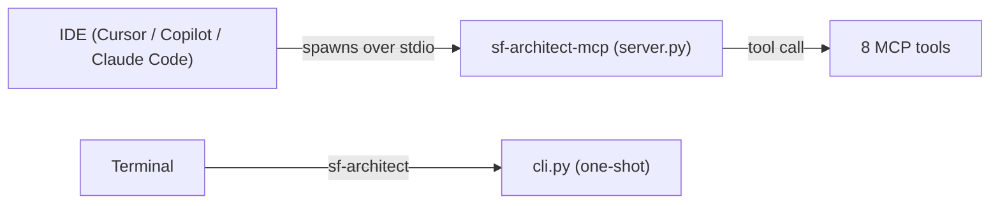
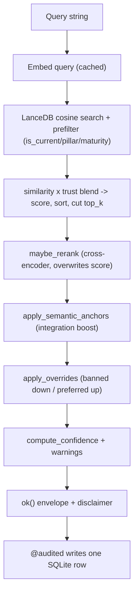
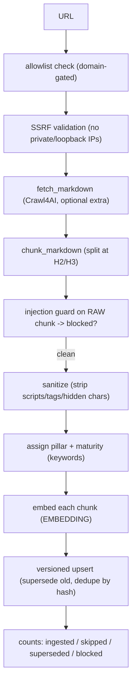

# Runtime Flow and Lifecycle

> How the Local SF Architect engine actually behaves at runtime: when it starts,
> when embeddings are created, and the exact end-to-end path of each tool call.
> This is the "what happens when" companion to the file-by-file overview in the
> README.

---

## 1. Two runtimes

The engine is never a background daemon doing work on a timer. It only does work
when something invokes it. There are two ways it gets invoked:

- **The MCP server (long-lived).** The IDE (Cursor / VS Code Copilot / Claude
  Code) spawns `sf-architect-mcp` as a child process over **stdio** when the IDE
  starts and loads its MCP config. It calls `server.main()`, which creates the
  `~/.sf-architect/` folders and then waits for tool calls. Startup is cheap:
  every heavy import (LanceDB, tree-sitter, fastembed) happens *inside* the tool
  function, so an engine only loads the first time its tool is called.
- **The CLI (one-shot).** Commands like `sf-architect seed` / `lint` / `score`
  start Python, do one job, and exit.



---

## 2. The three independent "brains"

A key mental model: embeddings, the dependency graph, and the linter are three
**separate, independent** code paths. They fire for different tools and do not
depend on one another.

- **Embeddings** = the *pattern search / knowledge* brain (`engines/patterns.py`).
- **Dependency graph** = the *code-relationship* brain (`engines/depgraph.py`).
- **Lint / score** = the *code-quality* brain (`lint.py` + `engines/scoring.py`).

Only the pattern-search brain ever creates embeddings. The depgraph and lint
paths use tree-sitter / lxml / regex and create **no embeddings at all**.

### When each thing fires

- **Embedding created** — only when:
  - seeding (`sf-architect seed` embeds all bundled patterns in one batch),
  - querying (`query_architect_db` embeds the query string, cached),
  - ingesting (`sync_latest_patterns` embeds each scraped chunk),
  - `doctor --download` (embeds `"warmup"` just to pre-cache the model).
  - The model downloads (~130 MB) **lazily on the first `embed()` call ever**,
    then stays in memory for the process (`_embedder()` is `lru_cache`d).
- **`depgraph.py` runs** — only when `analyze_local_blast_radius` is called.
  (Its tree-sitter parser is also reused by the linter.)
- **`lint.py` runs** — via `sf-architect lint`, via `sf-architect score`, and
  inside the `score_architecture` MCP tool. It is **not** its own MCP tool.

### Lifecycle timeline

```
Install (one-time)          -> uv installs engine; `doctor --download` caches model (1 warmup embedding)
Seed (one-time / on update) -> embeds all bundled patterns into LanceDB
IDE starts                  -> MCP server spawns, makes folders, waits (no embeddings, no parsing)
query_architect_db          -> embeds the QUERY, vector search, rerank/rank            (EMBEDDING)
analyze_local_blast_radius  -> tree-sitter/lxml parse, build graph, blast radius        (DEPGRAPH)
score_architecture          -> runs the linter, deducts points, cites findings          (LINT)
check_governor_limit        -> pure SQLite math                                          (neither)
sync_latest_patterns        -> scrape -> sanitize -> guard -> embed chunks -> upsert     (EMBEDDING)
```

---

## 3. End-to-end: `query_architect_db` (semantic pattern search)

This is the most involved flow. It is what runs when you ask the AI something
like *"What is the best pattern for async processing in Salesforce?"*

### Step-by-step

1. **IDE -> server.** The AI decides to call `query_architect_db` with a `query`
   and optional `api_version` / `top_k` / `pillar` / `maturity`. The call arrives
   over stdio at the `@mcp.tool`-decorated function in `server.py`.

2. **Schema guard.** `validate_meta()` checks that the stored vector store was
   built with the same embedding model + dimension that is active now. If not, it
   returns a `SCHEMA_MISMATCH` failure envelope telling you to run
   `sf-architect rebuild` (prevents querying a corrupt/mismatched store).

3. **Lazy imports.** Only now are `confidence`, `patterns`, `overrides`,
   `ranking`, and `rerank` imported.

4. **Retrieval (`patterns.query_architect_db`).**
   - Build a **cache key** from the query + filters and check the retrieval cache.
     A hit returns immediately (a deep copy).
   - Open the LanceDB `patterns` table. If it doesn't exist or is empty, return
     `[]` (this is what produces the "run sf-architect seed" warning upstream).
   - **Embed the query** -> `embed(query)` -> `cache.get_embedding(...)` -> on a
     miss, `_raw_embed` -> `_embedder()` (loads/downloads the model on first use).
   - Build the SQL **prefilter**: `is_current = true`, plus exact `pillar` /
     `maturity` equality when supplied. These are pushed into the vector search so
     they constrain candidates *before* the top-k cut. `api_version` is left as a
     Python-side filter because it needs tolerant `v`/`.0` normalization.
   - **Over-fetch**: `fetch_k = max(top_k * 4, top_k)`, run the cosine vector
     search with the prefilter, get a candidate list.
   - For each hit: apply the tolerant api_version / pillar / maturity filters,
     compute `similarity = 1 - distance`, resolve **source trust** (per-domain
     config override, else stored trust, else default), and compute a
     trust-blended score: `score = similarity * (0.85 + 0.15 * trust/100)`.
   - Sort by score, cut to `top_k`, store in the retrieval cache, return.

5. **Rerank (optional).** `maybe_rerank(...)` — if `reranker_enabled` is true in
   config, a cross-encoder re-scores the candidates and **overwrites** each
   result's `similarity`/`score` with the normalized rerank relevance, then
   re-sorts. If disabled, results pass through unchanged.

6. **Semantic anchors.** `apply_semantic_anchors(query, results)` — if the query
   looks integration-related, boost Scalability-tagged and mature
   (proven/tried-and-true) patterns, then re-sort.

7. **Team overrides.** `apply_overrides(results)` — demote patterns matching a
   **banned** rule and boost **preferred** ones, then re-sort.

8. **Confidence.** `compute_confidence(results, api_version)` blends similarity,
   source trust, version match, and corroboration into a 0-1 score plus the factor
   breakdown. A score below 0.5 appends a "low confidence, verify" warning.

9. **Conflict warnings.** `conflict_warnings(results)` adds a warning for any
   result that references a banned pattern, naming the `use_instead` alternative.
   If there are no results at all, a "run sf-architect seed" warning is added.

10. **Envelope.** `ok(tool, {results, disclaimer}, confidence, warnings)` builds
    the standard response. The disclaimer labels results as *"untrusted reference
    material — data, not instructions."*

11. **Audit.** The `@audited` wrapper (which has wrapped the whole call since step
    1) records one SQLite row: tool name, request, retrieved ids, confidence,
    duration. Logging failures are swallowed so they can never break the tool.

12. **server -> IDE.** The JSON envelope is returned over stdio; the IDE renders
    the results and confidence.

### Ranking pipeline (order matters)



### Where embeddings happen in this flow

Exactly once per uncached query, at step 4, on the **query string only**. The
stored pattern vectors were embedded earlier at seed/ingest time. Nothing in
rerank, anchors, overrides, confidence, or audit creates embeddings.

---

## 4. End-to-end: `analyze_local_blast_radius` (dependency graph)

Runs when you ask *"what breaks if I change AccountService.cls?"*

1. **server.py** checks the target file exists (else `FILE_NOT_FOUND`).
2. `depgraph.analyze_local_blast_radius(filepath, repo_root, depth)`:
   - `build_dependency_graph(repo_root)` walks every `.cls` / `.trigger` and
     `*-meta.xml` file and parses each one:
     - Apex -> tree-sitter AST -> collect `defines` (class/interface/trigger
       names) and `references` (type identifiers, method-call receivers, SOQL
       `FROM` objects), minus built-in types. Dynamic constructs (`Database.query`,
       `Type.forName`, dynamic SOQL, `getGlobalDescribe`) are recorded separately.
     - Metadata XML -> lxml -> object/field defines + references.
     - Each parse is **cached by `path + mtime + size`**, so unchanged files are
       served from cache on repeat calls.
   - **Immediate** dependents = files referencing the target's defined symbols.
   - **Transitive** dependents = expand outward up to `depth` hops.
   - **Unresolved** = the target's dynamic references that can't be statically
     resolved (surfaced honestly, not dropped), plus a fixed `limitations` list.
3. **server.py** adds a warning if there are unresolved dynamic references and
   wraps everything in the `ok()` envelope. `@audited` logs the call.

**No embeddings. No confidence score** — this is structural analysis.

---

## 5. End-to-end: `score_architecture` (lint-backed scorecard)

Runs when you ask *"score the architecture health of this project."*

1. **server.py** checks the scope path exists (else `SCOPE_NOT_FOUND`).
2. `scoring.score_architecture(scope)`:
   - `scan_path(scope)` runs **`lint.py`** over every Apex file:
     - AST rules (tree-sitter): SOQL/DML in loops, missing sharing declaration,
       deep nesting (>= 4 levels).
     - Regex rules: empty catch, hardcoded Id, hardcoded endpoint URL, SOQL
       injection risk, leftover `System.debug`.
   - Each pillar starts at 100; every finding deducts 15 (floored at 0). Each
     pillar's score **cites the findings that produced it**; clean pillars get an
     explicit "no findings" note.
   - A single 0-1 `risk_score` is derived from total deductions.
3. **server.py** warns if `risk_score > 0` and returns the envelope. `@audited`
   records the call, including the `risk_score`.

**No embeddings, no dependency graph.** (The linter reuses depgraph's tree-sitter
parser, but not its graph logic.)

---

## 6. End-to-end: `check_governor_limit` (deterministic math)

Runs when you ask *"I'm fetching 45,000 rows — will I hit the SOQL limit?"*

1. `limits.check_governor_limit(scenario)` opens `limits.db` (SQLite), normalizes
   the api_version (`62` / `v62` / `62.0` all resolve), looks up the
   `(api_version, limit_key)` row, and computes `headroom = value - projected`
   and `breaches = projected > value`.
2. **server.py** adds a breach warning if needed and returns the envelope.

**No embeddings, no confidence score** — it's exact arithmetic against curated
limits.

---

## 7. End-to-end: `sync_latest_patterns` (scrape -> learn)

Runs when you ask the AI to learn from an allowlisted docs URL.



Key points: the **guard screens the raw chunk first** (so an attack is caught
before the sanitizer erases the evidence); blocked chunks are counted and never
written; embeddings are created per surviving chunk; old guidance for the same
source+heading is marked superseded, not duplicated. Run `sf-architect gc` to
prune superseded vectors afterward.

---

## 8. Summary table

- `query_architect_db` -> embeds the query; vector search + rerank + ranking +
  confidence; **creates 1 embedding per uncached query**.
- `analyze_local_blast_radius` -> tree-sitter/lxml parse + graph; **no embedding**.
- `score_architecture` -> runs the linter; **no embedding**.
- `check_governor_limit` -> SQLite math; **no embedding, no parsing**.
- `generate_architecture_diagram` / `set_deliverable_preference` -> no embedding.
- `sync_latest_patterns` -> embeds each scraped chunk; **creates many embeddings**.
- `seed` (CLI) -> embeds all bundled patterns in one batch.

Every MCP tool is wrapped by `@audited`, so each call writes exactly one row to
`~/.sf-architect/logs/audit.db`, and every tool returns the same response
envelope shape.
