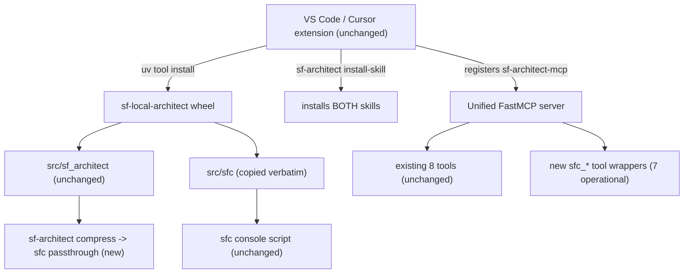

# Plan: Merge `sf-compress` (sfc) into the Local SF Architect Engine

> Status: PLANNING ONLY — nothing in this document has been implemented.
> This is the comprehensive, reviewed plan. A shorter tracked copy lives in
> `.cursor/plans/`.

---

## 1. Objective & hard constraints

Merge the **sf-compress** token/context compressor
(`https://github.com/personalaimaster-coder/sf-compress`) into the **Local SF
Architect Engine** so the engine gains dev-support output compression alongside
its existing architecture tooling.

Non-negotiable constraints (from the user):

- **Do not break anything existing.** The engine ships as a **running VS Code /
  Cursor extension** plus a published-style Python package; existing behavior
  must be preserved exactly.
- **>96% confidence** in the implementation before building.
- **Full unification** into one distribution (confirmed decision).
- **Integrated installers** — the existing extension and `sf-architect
  install-skill` should also set up sfc (confirmed decision).
- **Import everything** from the sf-compress repo, including
  `bundle/phase0-bundle/` transcripts and `MEMORY.md` (confirmed decision).
- **Security posture:** exposing `sfc_run` (subprocess exec) on the engine's MCP
  server is accepted; sfc stays default-OFF and project-local (confirmed).

### How we meet the ">96% / don't break anything" bar

Every change to existing `sf_architect` code is **strictly additive** — new MCP
tools, one new CLI subcommand, extra lines in the skill installer. **No existing
function body is modified.** sfc's source is copied **verbatim**, so its own test
suite keeps passing. The extension needs **zero code changes** (proven in §9).

---

## 2. What each project is (context)

### Local SF Architect Engine (the target)

- Python package `sf_architect`; distribution `sf-local-architect` **v0.3.0**;
  `requires-python >=3.12`; built with **hatchling**.
- Heavy deps: `fastmcp`, `lancedb`, `fastembed`, `lxml`, `tree-sitter`,
  `tree-sitter-language-pack`, `pyyaml`, `click`. Optional extra `scrape`.
- MCP server via **FastMCP** — `src/sf_architect/server.py` (`main()` →
  `mcp.run()`), console script `sf-architect-mcp`. Registered under MCP key
  `sf-local-architect`.
- CLI `sf-architect` (click): `doctor, seed, rebuild, gc, test, score,
  install-skill, lint`.
- Ships the `local-sf-architect` Agent Skill + writes `architect.mdc` rule +
  `AGENTS.md` (via `src/sf_architect/memory/persona.py`).
- Ships a VS Code / Cursor **extension** (`extension/`) that installs the engine
  via `uv`, registers the MCP server, and runs `sf-architect install-skill`.
- State: `~/.sf-architect/` (LanceDB vectors, `limits.db`, `audit.db`,
  `config.yaml`, `meta.json`).
- Domain: **analysis / architecture** — full detail matters.
- License: **Apache-2.0**.

### sf-compress (the source)

- Python package `sfc`; distribution `sf-compress` **v0.1.0**;
  `requires-python >=3.9`; **stdlib-only**; built with **setuptools**.
- Optional extra `graph = ["graphify-sf==0.4.1"]`.
- MCP server: hand-rolled **stdlib JSON-RPC** stdio server —
  `src/sfc/mcp_server.py` (`serve()`), launched by `sfc mcp`. Registered under
  MCP key `sf-compress`.
- CLI `sfc` (argparse): `setup, install-skill, mcp, on, off, status, run, show,
  stats, graph, collect, bench`.
- Ships the `sf-compress` Agent Skill + a `sfc setup` wizard
  (`src/sfc/agents.py`, `src/sfc/setup_wizard.py`).
- State: project-local `.sfc/` (`state.json`, `config.json`, `outputs/<id>.txt`,
  `metrics.jsonl`), self-ignored via `.sfc/.gitignore`.
- Domain: **dev-support** (deploy/test/debug-log/retrieve/query), default **OFF**;
  explicitly must **not** run during analysis/architecture.
- License: **MIT**.

---

## 3. Feasibility verdict: confirmed (high confidence)

The two tools are **complementary by design** and share **no namespaces**. The
sf-compress skill literally says "DO NOT TRIGGER during analysis/architecture" —
exactly the engine's domain — so they coexist cleanly in one `mcp.json`.

### Collision matrix (all distinct — no clashes)

| Surface | Engine | sf-compress | Collision? |
|---|---|---|---|
| Python module | `sf_architect` | `sfc` | No |
| Distribution name | `sf-local-architect` | `sf-compress` | No |
| Console scripts | `sf-architect`, `sf-architect-mcp` | `sfc` | No |
| MCP server key | `sf-local-architect` | `sf-compress` | No (unified → single key) |
| MCP tool names | `query_architect_db`, `check_governor_limit`, … | `sfc_*` | No |
| Agent Skill name | `local-sf-architect` | `sf-compress` | No |
| State dir | `~/.sf-architect/` | `./.sfc/` | No |
| Test filenames | `test_limits.py`, … | `test_cli.py`, `test_filters.py`, … | No |
| Build backend | hatchling | setuptools | N/A (sfc's pyproject not copied) |
| `requires-python` | `>=3.12` | `>=3.9` | No (sfc stdlib-only runs on 3.12) |

The only mismatches are packaging-level and only matter if the two were fused
into a *single module namespace* — which we are **not** doing. We ship **one
distribution with two top-level modules**.

---

## 4. Target architecture



- **One distribution** (`sf-local-architect`) ships both `sf_architect` and `sfc`.
- **One MCP server** (`sf-architect-mcp`) exposes the existing 8 tools **plus** 7
  sfc tools.
- **Both console scripts** kept: `sf-architect` and `sfc`; plus a new
  `sf-architect compress …` alias.
- The extension picks everything up **without any extension code change**.

---

## 5. Decisions locked in

- Unify = **single distribution, two modules, both console scripts** (not a full
  namespace rewrite). Lowest risk form of "unify."
- Installers = **integrated** via extending `sf-architect install-skill`
  (the extension already calls it → no extension edits).
- Scope = **import everything** from sf-compress.
- Security = **accept** `sfc_run`; keep sfc default-OFF.

### Refinements discovered in deep review (improvements/fixes)

1. **Skill install uses sfc's own loader.** Install the sfc skill by calling
   `sfc.agents.install_skill(repo_root, subdir)` (which reads the packaged asset
   via `importlib.resources` → `skill_text()`), rather than copying from
   `skills/`. Robust for both wheel and source installs; avoids touching the
   engine's `repo_skill_dir()` resolution.
2. **Expose only the 7 operational sfc tools** on the unified server
   (`sfc_status, sfc_on, sfc_off, sfc_run, sfc_show, sfc_stats, sfc_graph`).
   **Do NOT** expose `sfc_setup` / `sfc_install_skill`: sfc's
   `agents.register_mcp()` would write a *second* `sf-compress` server entry into
   `~/.cursor/mcp.json`, competing with the unified server. The engine's own
   `install-skill` handles wiring, so those two are redundant and a footgun.
3. **Test hermeticity — VERIFIED RESOLVED.** `sfc.state.find_root()` walks up for
   `.git/`, and the engine repo root has `.git`. However, reading the actual sfc
   tests confirms every one that touches state (`test_cli.py`, `test_setup.py`,
   `test_mcp_server.py`, `test_workbench.py`) does `os.chdir(TemporaryDirectory())`
   in `setUp` and restores in `tearDown`, so **no stray `.sfc/` is written into the
   repo**. The drift-guard test only reads `REPO/skills/...` and
   `REPO/src/sfc/assets/...` (both present after import). Residual action: still add
   `.sfc/` to the repo `.gitignore` as a backstop. Confidence: high.

---

## 6. Exactly what gets imported (everything)

Copied into the engine repo on a new branch (`feat/merge-sf-compress`):

- `src/sfc/**` → alongside `src/sf_architect/` (second top-level package;
  `pythonpath=["src"]` already makes it importable in tests).
  - includes `src/sfc/assets/skills/sf-compress/SKILL.md` (packaged skill asset).
- `skills/sf-compress/**` → into `skills/` (next to `local-sf-architect/`); kept
  for browsing and for sfc's drift guard
  (`test_setup.py::test_repo_copy_in_sync_with_packaged`).
- sfc `tests/*` → into `tests/` — `test_cli.py, test_delta.py, test_filters.py,
  test_graph.py, test_mcp_server.py, test_setup.py, test_workbench.py, synth.py`.
  (Verified: no filename collisions with the engine's 27 test files.)
- `docs/org-workbench.md` → `docs/`.
- sf-compress `README.md` → `docs/sf-compress.md` (do **not** clobber root
  `README.md`).
- `MEMORY.md` → repo root (project memory, per "import everything").
- `bundle/phase0-bundle/**` → new top-level `bundle/` (de-identified aggregates
  + agent transcripts).

**Not** copied (merged/handled instead):

- sf-compress `pyproject.toml` → its needed bits merged into the engine's
  `pyproject.toml` (see §7).
- sf-compress `.gitignore` → relevant entries merged into the engine `.gitignore`.

---

## 7. Packaging changes — `pyproject.toml` (additive)

- Wheel packages:
  `packages = ["src/sf_architect", "src/sfc"]`.
- **Skill asset shipping (corrected):** because `src/sfc/assets/.../SKILL.md` lives
  *inside* the `sfc` package, hatchling includes it **by default** once `src/sfc`
  is a wheel package — no force-include needed. (The engine force-includes its own
  skill only because that one lives *outside* `src/`, at the repo-root `skills/`.)
  Adding a force-include for the in-package asset would target the same wheel path
  and risk a duplicate-path build error, so we rely on default inclusion and
  **verify** it in the wheel (§18 Phase 2 check). Force-include is a fallback only
  if verification shows it missing.
- Optional extra:
  `[project.optional-dependencies] graph = ["graphify-sf==0.4.1"]`
  (matches sfc's `TESTED_VERSION`).
- Console script: add `sfc = "sfc.cli:main"` under `[project.scripts]`.
- Keep `requires-python = ">=3.12"` (sfc is stdlib-only; graphify extra needs
  3.10+ — both satisfied).
- sdist `include` list: deliberately **leave `bundle/` out of the sdist** (large
  transcripts), mirroring how `extension/` is already excluded. It stays in the
  repo, just not in the published source tarball.
- Bump version `0.3.0 → 0.4.0` (new user-facing capability).
- No new **core** runtime dependencies (sfc core is stdlib-only).

---

## 8. Unified MCP server — `src/sf_architect/server.py` (additive only)

- Add `@mcp.tool @audited` wrappers for the 7 operational sfc tools, each
  delegating to the existing handlers in `src/sfc/mcp_server.py` (`_t_status`,
  `_t_on`, `_t_off`, `_t_run`, `_t_show`, `_t_stats`, `_t_graph`).
- Each wrapper returns the plain text payload
  (`result["content"][0]["text"]`) to avoid FastMCP double-wrapping the
  `{content, isError}` shape sfc produces.
- The existing 8 tools are **not touched**. Server name stays
  `sf-local-architect`, so there is still a **single** MCP entry exposing both
  toolsets.
- `@audited` on the sfc wrappers keeps a consistent audit trail in
  `~/.sf-architect/logs/audit.db` (sfc also keeps its own `.sfc/metrics.jsonl`).
  **Verified safe for plain-text returns:** `audit._extract_from_envelope` returns
  `(None, None, None)` for non-dict results, and the existing `health_echo` tool
  already uses `@audited` with a `str` return — so sfc wrappers returning text do
  not break auditing.

Why not `sfc_setup` / `sfc_install_skill` as MCP tools: see §5, fix 2.

---

## 9. CLI alias — `src/sf_architect/cli.py` (additive)

Add a passthrough command so engine users have one entry point while the proven
`sfc` CLI stays intact:

```python
@main.command(context_settings=dict(ignore_unknown_options=True, allow_extra_args=True))
@click.argument("args", nargs=-1, type=click.UNPROCESSED)
def compress(args):
    """Run the bundled sf-compress (sfc) dev-support compressor."""
    from sfc.cli import main as sfc_main
    raise SystemExit(sfc_main(list(args)))
```

Usage: `sf-architect compress run -- sf project deploy start -d force-app`.
The standalone `sfc` console script remains available and unchanged.

---

## 10. Installer integration — `src/sf_architect/memory/persona.py` (additive)

- Extend `install_skill(...)` so that, in the same loop over `AGENT_SKILL_DIRS`
  (`cursor → .cursor/skills`, `claude → .claude/skills`, `vibes → .vibes/skills`),
  it **also** installs the sfc skill via
  `sfc.agents.install_skill(repo_root, str(rel))` (reads the packaged asset).
- Do **not** register a second MCP server — the sfc tools are served by the
  unified `sf-architect-mcp`.
- Standalone `sfc setup` still works for non-engine users; it is simply
  unnecessary once the engine installer has run. Documented as such.

### Why the extension needs ZERO changes (proof)

From `extension/src/setup.ts` → `installSkillIntoWorkspace()` runs
`sf-architect install-skill <folder>`. From `extension/src/constants.ts` the
server is `MCP_SCRIPT = "sf-architect-mcp"` under key `sf-local-architect`, and
`extension/src/engine.ts` installs/upgrades the `sf-local-architect` package.
Therefore:

- The extension installs/upgrades the package → now also ships `sfc`.
- The extension registers `sf-architect-mcp` → now also exposes `sfc_*`.
- The extension calls `install-skill` → now also drops the `sf-compress` skill.

No file under `extension/` is edited. (Optional, not required: a CHANGELOG note.)

---

## 11. Housekeeping

- Add `.sfc/` to the repo `.gitignore` (and keep sf-compress's `*.pyc`,
  `__pycache__/`, `__MACOSX/` if not already present).
- **License hygiene:** the distribution is Apache-2.0; sfc is MIT. Retain sfc's
  MIT notice (e.g., `src/sfc/LICENSE` or a top-level `NOTICE` entry). MIT is
  compatible with redistribution under Apache-2.0 provided its notice is kept.
- README: add a short "Dev-support compression (sfc)" section linking
  `docs/sf-compress.md`, and a note that the MCP server can now run `sf`
  subprocesses (default-OFF, project-local).

---

## 12. Security posture change (acknowledged)

- Today the engine advertises "no attack surface, code never leaves your
  machine." Adding `sfc_run` lets the server execute arbitrary `sf`/shell
  subprocesses. This is a **new capability**, accepted by the user.
- Mitigations kept intact: sfc is **default-OFF** (`sfc run` exits 3 when off),
  state is **project-local**, and nothing is stored/metered while off.
- `tests/test_no_network.py` blocks **sockets only** and exercises just the
  deterministic tools — it does **not** touch subprocesses or sfc, so it keeps
  passing. The posture change is about process exec, not network egress; the
  no-network guarantee is unaffected.
- Document the change in the README security section.

---

## 13. Test strategy

- Merge sfc's tests into `tests/`; run the whole suite under the engine's
  `pytest` (`[tool.pytest.ini_options] testpaths=["tests"] pythonpath=["src"]`).
  pytest runs sfc's stdlib `unittest`-style tests fine.
- **Hermeticity — verified** (see §5, fix 3): all sfc tests `os.chdir` into a
  temp dir in `setUp`/`tearDown`, so none write `.sfc/` into the repo. `.sfc/`
  still added to `.gitignore` as a backstop.
- Add a small test asserting the unified server lists the original 8 tools **and**
  the 7 `sfc_*` tools.
- Keep sfc's drift guard working (both `skills/sf-compress/SKILL.md` and the
  packaged copy present).

---

## 14. Risk register

| Risk | Likelihood | Impact | Mitigation |
|---|---|---|---|
| Hatchling omits sfc's `.md` skill asset from the wheel | Low | Med | Explicit force-include (§7) + inspect built wheel (§15) |
| sfc test writes stray `.sfc/` into repo (`.git` root) | Very Low (verified) | Low | sfc tests already `os.chdir` to temp dirs; `.sfc/` in `.gitignore` backstop |
| Double MCP registration (`sf-compress` + unified) | Low | Low | Don't expose `sfc_setup`/`sfc_install_skill`; installer skips `register_mcp` (§5) |
| Existing engine behavior regresses | Very Low | High | Additive-only edits; full existing suite must pass (§15) |
| Extension breaks | Very Low | High | No extension edits; verified wiring (§10) |
| License non-compliance | Low | Med | Retain MIT notice (§11) |
| sdist bloat from `bundle/` transcripts | Low | Low | Exclude `bundle/` from sdist (§7) |
| FastMCP double-wraps sfc output | Low | Low | Return plain text payload from wrappers (§8) |

---

## 15. Verification checklist (the gate before "done")

1. `uv sync` then `uv run pytest` → **entire** suite green (existing + imported
   sfc tests). Confirm `tests/test_no_network.py` passes.
2. `uv build`; inspect the wheel: `src/sfc/**` present and the bundled
   `sf-compress/SKILL.md` is included.
3. Smoke tests:
   - `sf-architect --help` shows `compress`; `sfc --version` works.
   - `sf-architect install-skill /tmp/proj` drops **both** skills
     (`local-sf-architect` + `sf-compress`) into each agent dir and does **not**
     add a second MCP server entry.
   - `sf-architect-mcp` `tools/list` returns the original 8 **plus** the 7
     `sfc_*` tools; existing tools behave identically.
   - `sf-architect compress status` / `compress on` / `compress run -- echo hi`
     behave like the native `sfc` CLI.
4. Confirm no stray `.sfc/` appears in the repo working tree after the test run.

---

## 16. Rollback

- All work on branch `feat/merge-sf-compress`; nothing merged to `main` until the
  checklist passes.
- Because changes are additive and sfc lives in its own module, reverting is a
  branch delete / `git revert` with no impact on `sf_architect`.

---

## 17. Context completeness & open questions

- **Context:** complete for planning. All load-bearing sf-compress files were
  reviewed (`pyproject.toml`, `README.md`, `MEMORY.md`, `mcp_server.py`,
  `cli.py`, `__main__.py`, `__init__.py`, both `SKILL.md`, `agents.py`,
  `state.py`, `setup_wizard.py`, `graph.py`, `.gitignore`). Remaining files
  (`runner.py`, `store.py`, `metering.py`, `delta.py`, `filters/*`,
  `workbench/*`) are copied verbatim and do not alter the plan.
- **Nothing further needed from the user's repo** that cannot be fetched via
  `gh`.
- **No open questions remain.** The previously-deferred item (confirming sfc test
  hermeticity) has now been checked directly and resolved (§5 fix 3), and the
  `@audited` plain-text behavior is verified (§8).

### Single-extension confirmation (explicit)

- There will be **exactly one** extension: the existing `sf-local-architect`. No
  separate sf-compress extension is created or published.
- sf-compress has **no UI of its own** — its whole feature surface is CLI + MCP
  tools + Agent Skill, and all three become reachable through the one extension.
  So "every sf-compress feature available inside sf-local-architect" is satisfied
  with **zero** extension code changes.
- **Optional (out of scope unless you ask):** surfacing sfc controls (an on/off
  toggle / command-palette entries) in the extension's status bar. This would
  *add* UI that sf-compress never had and would require editing `extension/`, so
  it is intentionally excluded to protect the "don't break the running extension"
  guarantee. Flag it and it becomes Phase 7 below.

---

## 18. Implementation plan (ordered, execution-ready)

All work on branch `feat/merge-sf-compress`. Each phase is independently
verifiable; do not proceed to the next until its check passes. Phases 1-6 involve
**no** `extension/` edits.

### Phase 0 — Branch & baseline
1. `git checkout -b feat/merge-sf-compress`.
2. Capture a green baseline: `uv sync` then `uv run pytest -q` (record the pass
   count so we can prove no regressions later).

### Phase 1 — Import sources (no wiring yet)
1. Copy `sf-compress/src/sfc/**` → `src/sfc/**` (verbatim).
2. Copy `sf-compress/skills/sf-compress/**` → `skills/sf-compress/**`.
3. Copy sfc tests → `tests/` (`test_cli.py, test_delta.py, test_filters.py,
   test_graph.py, test_mcp_server.py, test_setup.py, test_workbench.py, synth.py`).
4. Copy `docs/org-workbench.md` → `docs/`; `README.md` → `docs/sf-compress.md`;
   `MEMORY.md` → repo root; `bundle/**` → `bundle/`.
5. Add `.sfc/` to `.gitignore`; add sfc's MIT notice as `src/sfc/LICENSE` (and a
   root `NOTICE` line).
- **Check:** `uv run python -c "import sfc, sf_architect"` succeeds;
  `uv run pytest -q` shows baseline + sfc tests all green (sfc tests find
  `src/` via their own `sys.path.insert`).

### Phase 2 — Packaging (`pyproject.toml`)
1. `wheel.packages = ["src/sf_architect", "src/sfc"]`.
2. `[project.optional-dependencies] graph = ["graphify-sf==0.4.1"]`.
3. `[project.scripts]` add `sfc = "sfc.cli:main"`.
4. Bump `version = "0.4.0"`.
- **Check:** `uv build`; unzip the wheel and confirm `sfc/` **and the in-package
  `sfc/assets/skills/sf-compress/SKILL.md`** are present (default inclusion), plus
  the `sfc` + `sf-architect` + `sf-architect-mcp` entry points. If the `.md` is
  missing, add the force-include fallback (see §7) and rebuild. `uv run sfc
  --version` works.

### Phase 3 — Unified MCP server (`src/sf_architect/server.py`, additive)
1. Add 7 `@mcp.tool @audited` wrappers (`sfc_status, sfc_on, sfc_off, sfc_run,
   sfc_show, sfc_stats, sfc_graph`), each delegating to the matching
   `sfc.mcp_server._t_*` handler and returning
   `result["content"][0]["text"]`.
2. Do **not** add `sfc_setup`/`sfc_install_skill`.
- **Check:** start `sf-architect-mcp`, send `tools/list`; assert the original 8
  tools plus exactly the 7 `sfc_*` tools; call `sfc_status` → "OFF"; call an
  existing tool (e.g. `check_governor_limit`) and confirm unchanged output.

### Phase 4 — CLI alias (`src/sf_architect/cli.py`, additive)
1. Add the `compress` passthrough command forwarding to `sfc.cli.main`.
- **Check:** `sf-architect --help` lists `compress`;
  `sf-architect compress status` mirrors `sfc status`;
  `sf-architect compress run -- echo hi` behaves like native `sfc`.

### Phase 5 — Installer integration (`src/sf_architect/memory/persona.py`, additive)
1. In `install_skill(...)`, after copying the `local-sf-architect` skill, also call
   `sfc.agents.install_skill(repo_root, str(rel))` for each agent dir in
   `AGENT_SKILL_DIRS` (cursor/claude/vibes). No MCP re-registration.
2. (Optional) extend `write_persona` text to mention the compressor; not required.
- **Check:** `sf-architect install-skill /tmp/proj` creates BOTH
  `.cursor/skills/local-sf-architect/` and `.cursor/skills/sf-compress/`
  (and for claude/vibes), and does **not** add a `sf-compress` MCP server to any
  `mcp.json`.

### Phase 6 — Docs, license, final verification
1. README: add "Dev-support compression (sfc)" section linking
   `docs/sf-compress.md`; add the security-posture note (server can now run `sf`
   subprocesses, default-OFF).
2. Run the full §15 verification checklist end-to-end.
- **Check (release gate):** entire `uv run pytest -q` green (no regressions vs
  Phase 0 baseline); `uv build` wheel inspection clean; all smoke tests pass; no
  stray `.sfc/` in the working tree; `git status` shows only intended files.

### Phase 7 — OPTIONAL extension UI (only if you request it)
- Add sfc on/off/status to the extension status bar + command palette
  (`extension/src/statusBar.ts`, `extension/src/extension.ts`,
  `extension/package.json` contributes). This is the only phase that edits
  `extension/`; excluded by default.

### Suggested commit sequence
`import-sfc-sources` → `packaging-merge` → `unified-mcp-tools` →
`cli-compress-alias` → `installer-dual-skill` → `docs-license-readme`. Small,
reviewable commits; each maps to a phase above.

---

## 19. Exact code changes (pre-reviewed snippets)

These are the precise edits so the implementation is fully reviewed before any
code is touched. All are **additive**; no existing function body is modified.

### 19.1 `pyproject.toml` (diff-style)

```toml
[project]
-version = "0.3.0"
+version = "0.4.0"

[project.optional-dependencies]
 scrape = ["crawl4ai>=0.8"]
+graph = ["graphify-sf==0.4.1"]            # sfc exploration-graph extra (opt-in)

[project.scripts]
 sf-architect = "sf_architect.cli:main"
 sf-architect-mcp = "sf_architect.server:main"
+sfc = "sfc.cli:main"                       # bundled sf-compress CLI

[tool.hatch.build.targets.wheel]
-packages = ["src/sf_architect"]
+packages = ["src/sf_architect", "src/sfc"]
```

(No change to `[tool.hatch.build.targets.wheel.force-include]`: the sfc skill
asset ships via default in-package inclusion — see §7. The sdist `include` list is
left as-is, so `bundle/` stays out of the published tarball.)

### 19.2 `src/sf_architect/server.py` — append the 7 sfc tools (additive)

`Any` and `from __future__ import annotations` are already imported at the top, so
the annotations below are valid. Insert before `def main()`:

```python
# --- sf-compress (sfc) dev-support tools -------------------------------------
# Delegate to the bundled sfc compressor (src/sfc) so this single
# sf-local-architect MCP server covers both architecture analysis and
# dev-support compression. Setup/skill-install are intentionally NOT exposed
# here (that is handled by `sf-architect install-skill`), which avoids sfc
# registering a competing second MCP server.

def _sfc_text(result: dict) -> str:
    """Flatten an sfc MCP result ({"content":[{"text":...}], "isError":...}) to text."""
    parts = [
        c.get("text", "")
        for c in (result.get("content") or [])
        if isinstance(c, dict)
    ]
    return "\n".join(p for p in parts if p) or "(no output)"


@mcp.tool
@audited
def sfc_status() -> str:
    """Report whether the sfc compressor is ACTIVE or OFF for this project."""
    from sfc.mcp_server import _t_status

    return _sfc_text(_t_status({}))


@mcp.tool
@audited
def sfc_on() -> str:
    """Activate sfc for dev-support work (deploy/test/debug-log/retrieve/query)."""
    from sfc.mcp_server import _t_on

    return _sfc_text(_t_on({}))


@mcp.tool
@audited
def sfc_off() -> str:
    """Deactivate sfc (fully dormant). Use when leaving dev-support work."""
    from sfc.mcp_server import _t_off

    return _sfc_text(_t_off({}))


@mcp.tool
@audited
def sfc_run(command: list[str] | str) -> str:
    """Run a Salesforce dev command through the compressor and return the compressed
    view (full raw output is stored on disk; expand it later with sfc_show)."""
    from sfc.mcp_server import _t_run

    return _sfc_text(_t_run({"command": command}))


@mcp.tool
@audited
def sfc_show(
    id: str,
    grep: str | None = None,
    head: int | None = None,
    tail: int | None = None,
) -> str:
    """Expand a stored full raw output by id; narrow with grep/head/tail."""
    from sfc.mcp_server import _t_show

    args: dict[str, Any] = {"id": id}
    if grep is not None:
        args["grep"] = grep
    if head is not None:
        args["head"] = head
    if tail is not None:
        args["tail"] = tail
    return _sfc_text(_t_show(args))


@mcp.tool
@audited
def sfc_stats() -> str:
    """Token savings per command family (raw vs emitted)."""
    from sfc.mcp_server import _t_stats

    return _sfc_text(_t_stats({}))


@mcp.tool
@audited
def sfc_graph(args: list[str] | str) -> str:
    """Query the graphify-sf code graph to locate code/dependencies (needs the
    exploration-graph toggle). A first-pass locator - verify callers in source."""
    from sfc.mcp_server import _t_graph

    return _sfc_text(_t_graph({"args": args}))
```

### 19.3 `src/sf_architect/cli.py` — add the `compress` passthrough (additive)

Insert as a new command on the existing `main` group (e.g. after `lint`):

```python
@main.command(
    context_settings=dict(ignore_unknown_options=True, allow_extra_args=True),
    add_help_option=False,  # forward --help to sfc's own parser
)
@click.argument("args", nargs=-1, type=click.UNPROCESSED)
def compress(args: tuple[str, ...]) -> None:
    """Run the bundled sf-compress (sfc) dev-support compressor.

    Thin passthrough: `sf-architect compress <args>` == `sfc <args>`.
    Example: sf-architect compress run -- sf project deploy start -d force-app
    """
    from sfc.cli import main as sfc_main

    raise SystemExit(sfc_main(list(args)))
```

### 19.4 `src/sf_architect/memory/persona.py` — also install the sfc skill (additive)

Inside the existing `for agent in agents:` loop in `install_skill(...)`, append the
sfc-skill install right after the architect skill is copied:

```python
        shutil.copytree(source, target)
        written[agent] = str(target)

        # Also install the bundled sf-compress (sfc) dev-support skill into the
        # same agent dir, via sfc's packaged-asset loader (works from wheel or
        # source). No MCP re-registration: sfc tools are served by this engine's
        # unified sf-architect-mcp server. Best-effort: never break the architect
        # skill install if the sfc asset is somehow unavailable.
        try:
            from sfc import agents as _sfc_agents

            sfc_dest = _sfc_agents.install_skill(repo_root, str(rel))
            written[f"{agent}:sf-compress"] = str(sfc_dest)
        except Exception:
            pass
```

`_sfc_agents.install_skill(root, subdir)` writes
`<root>/<subdir>/sf-compress/SKILL.md`; with `rel` = `.cursor/skills` it lands at
`.cursor/skills/sf-compress/SKILL.md`, beside `.cursor/skills/local-sf-architect/`.

### 19.5 New regression test — `tests/test_sfc_integration.py`

```python
"""Merge guardrail: the unified server exposes both toolsets; sfc is importable."""

import importlib


def test_unified_server_exposes_both_toolsets():
    server = importlib.import_module("sf_architect.server")
    # FastMCP keeps registered tools; access via the public tool manager.
    names = set(server.mcp._tool_manager._tools.keys())  # adjust to FastMCP API
    architect = {
        "health_echo", "query_architect_db", "analyze_local_blast_radius",
        "check_governor_limit", "generate_architecture_diagram",
        "set_deliverable_preference", "score_architecture", "sync_latest_patterns",
    }
    sfc_tools = {
        "sfc_status", "sfc_on", "sfc_off", "sfc_run",
        "sfc_show", "sfc_stats", "sfc_graph",
    }
    assert architect.issubset(names)
    assert sfc_tools.issubset(names)
    # setup/install-skill are deliberately NOT exposed on the unified server
    assert "sfc_setup" not in names and "sfc_install_skill" not in names


def test_sfc_is_importable_in_same_env():
    assert importlib.import_module("sfc") is not None
```

> Note: the exact FastMCP introspection API (`mcp._tool_manager._tools` vs
> `mcp.list_tools()`) will be confirmed against the installed `fastmcp>=3.4`
> during Phase 3; the test asserts the same intent either way.

---

## 20. Rollback & validation runbook

### 20.1 Per-phase commit messages

- Phase 1: `feat(sfc): import sf-compress sources (verbatim) + MIT notice`
- Phase 2: `build(sfc): ship sfc in the wheel (packages, sfc script, graph extra, v0.4.0)`
- Phase 3: `feat(mcp): expose 7 sfc_* dev-support tools on the unified server`
- Phase 4: `feat(cli): add 'sf-architect compress' passthrough to sfc`
- Phase 5: `feat(install): install sf-compress skill alongside local-sf-architect`
- Phase 6: `docs(sfc): README section, security-posture note, merge plan`

### 20.2 Validation commands (run at the Phase 6 gate)

```bash
uv sync
uv run pytest -q                      # must match/exceed the Phase 0 baseline count
uv run pytest tests/test_no_network.py -q
uv build && python -c "import zipfile,glob;\
 z=zipfile.ZipFile(sorted(glob.glob('dist/*.whl'))[-1]);\
 print('\n'.join(n for n in z.namelist() if 'sfc' in n))"
uv run sfc --version
uv run sf-architect --help | grep -q compress && echo 'compress OK'
uv run sf-architect install-skill /tmp/sfc-smoke && \
  ls /tmp/sfc-smoke/.cursor/skills      # expect BOTH skill dirs, no mcp.json edit
git status --porcelain                 # expect only intended files; no stray .sfc/
```

### 20.3 Rollback

- Everything is on `feat/merge-sf-compress`; `main` is never touched until the gate
  passes. To abandon: `git checkout main && git branch -D feat/merge-sf-compress`.
- Per-phase revert: `git revert <phase-commit>` — because each phase is additive and
  isolated (sfc lives in its own module), reverting any single phase leaves the
  existing `sf_architect` behavior intact.
- Fastest kill-switch if a user hits trouble post-merge: the sfc tools are
  default-OFF and the `compress`/`sfc` surfaces are opt-in, so no rollback is
  needed for normal architect usage.

---

## 21. Phase 7 (extension UI) — decision

**Recommendation: keep it excluded for the initial merge.** Rationale:

- sf-compress ships no UI, so excluding it still satisfies "every sf-compress
  feature is available inside sf-local-architect" (features reach the user via the
  bundled CLI, the unified MCP tools, and the installed skill).
- Editing `extension/` is the only change that touches the **running extension**;
  keeping Phases 1-6 extension-free is what preserves the "don't break anything"
  guarantee and the >96% confidence.
- It is a clean **fast-follow**: once the merge is proven green, a small Phase 7 PR
  can add an sfc on/off status-bar item + command-palette entries
  (`extension/src/statusBar.ts`, `extension/src/extension.ts`, and `contributes`
  in `extension/package.json`) without affecting the engine package.

If you want sfc controls in the extension UI as part of this effort, say so and I
will promote Phase 7 into the active plan with its own test/verification steps.
